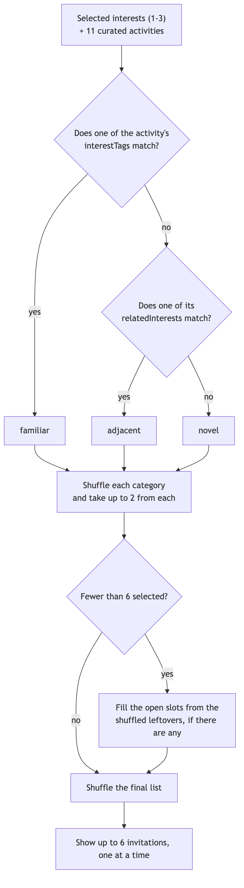
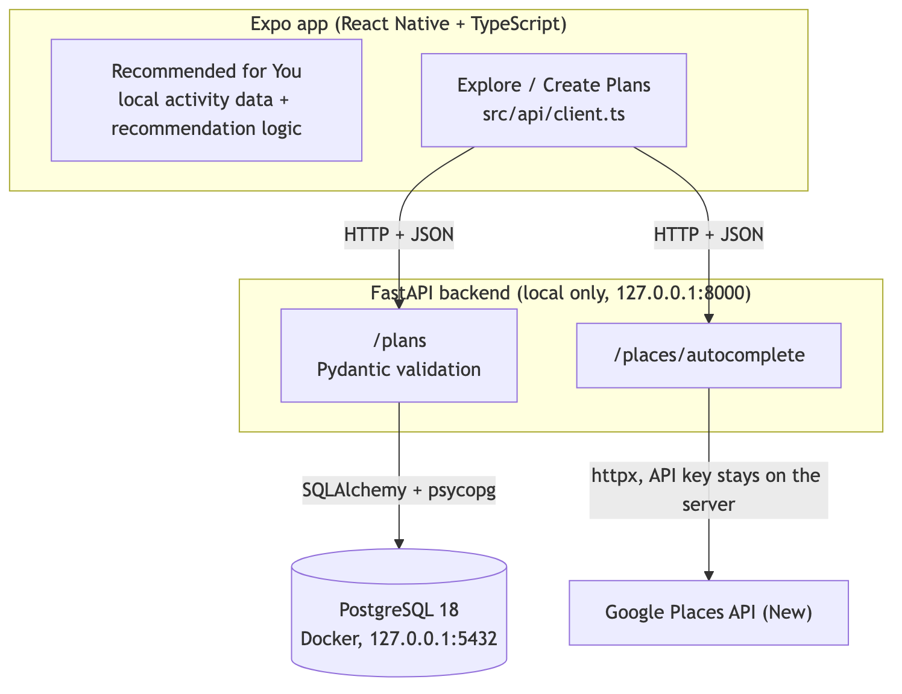
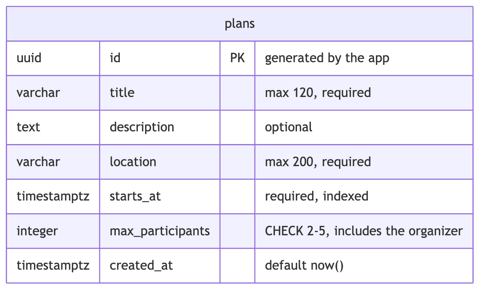

# Serendipity

Serendipity is an app that helps people find spontaneous activities nearby and meet new people in small groups. It's mainly for college students and young professionals who are new to a city, starting with San Francisco.

For Sprint 1, I built a prototype to test how people respond to activity recommendations, including activities outside their usual interests. I also started building the actual app, where users can create plans and discover plans made by others.

The frontend uses React Native, Expo, TypeScript, and Expo Router. The backend uses FastAPI and PostgreSQL.

## Features

### Activity recommendations

This is the original prototype I built for user testing. It works without the backend.

- Users start by selecting 1–3 interests.
- The app recommends up to 6 activities from a dataset of 11 activities in San Francisco.
- Activities are classified as familiar, adjacent, or novel based on the user's selected interests. The algorithm tries to recommend 2 from each category and randomizes the order.
- These classifications aren't shown while users are making their decisions, since I don't want them to influence the testing results.
- Each activity shows its location, estimated cost, a Google Maps link, and a simulated group of people.
- Users can select "I'm in" or "Not today" for each activity.
- At the end, there's a researcher summary showing the activities, their classifications, the order they appeared in, and the user's decisions.

How the recommendations are chosen:



The invitations and groups are simulated for testing. Clicking "I'm in" doesn't actually join an event. The decisions are also only stored in memory for now.

### Creating and exploring plans

I also started implementing the actual plan creation and discovery features. These use the FastAPI backend and PostgreSQL.

**Create a Plan**

Users can create a plan by entering:

- Title and optional description
- Location
- Date and time
- Group size (2–5 people, including the organizer)

Plans use San Francisco time and can only start between 9 AM and 7 PM. Both the frontend and backend validate this.

On the web version, I added date and time pickers to make entering this information easier. I also integrated Google Places autocomplete so users can search for locations in San Francisco.

**Explore Plans**

Users can browse plans stored in PostgreSQL. The app shows upcoming plans, ordered by start time, with a maximum of 50 results.

**Plan Details**

Users can open a plan to see its information. The details page also works if opened directly or refreshed.

For now, these features only work locally because the backend hasn't been deployed.

## Architecture



The diagram sources are in [docs/diagrams.md](docs/diagrams.md).

The backend is inside `backend/`, separate from the Expo app.

For plan creation and discovery, Expo sends HTTP requests to FastAPI. FastAPI validates the data using Pydantic and uses SQLAlchemy to interact with PostgreSQL.

For location suggestions, the frontend sends the search text to FastAPI, which makes the request to Google Places. This keeps the Google API key on the backend instead of exposing it in the app.

### API endpoints

| Endpoint | What it does |
|---|---|
| `GET /health` | Checks that the API is running |
| `POST /plans` | Creates a plan |
| `GET /plans` | Returns upcoming plans, ordered by time |
| `GET /plans/{id}` | Returns one plan by its ID |
| `GET /places/autocomplete?q=...` | Returns up to 5 location suggestions |

FastAPI also generates interactive API documentation at:

http://127.0.0.1:8000/docs

This is available when the backend is running locally.

## Database

I used PostgreSQL for storing plans and SQLAlchemy to interact with it from Python.

There's currently one table, `plans`, defined in `backend/app/models.py`.



The backend uses two Pydantic schemas, `PlanCreate` and `PlanRead`, to validate requests and define responses. This also prevents users from providing fields like `id` or `created_at` when creating a plan.

For Sprint 1, I used `Base.metadata.create_all()` in `backend/app/init_db.py` to create the table. I decided to postpone Alembic migrations to Sprint 2 because I wanted to focus on getting the API working first.

## Running locally

You'll need:

- Node.js (I used Node 24)
- Python 3.11 or newer (I used Python 3.14)
- Docker Desktop

### 1. Run the frontend

From the project root:

```bash
npm install
npx expo start
```

Press `w` to open it in your browser, or scan the QR code using [Expo Go](https://expo.dev/go).

If the phone can't connect through the local network, you can try:

```bash
npx expo start --tunnel
```

You may need to sign in to your Expo account.

The recommendation prototype works without starting the backend.

### 2. Run PostgreSQL and FastAPI

From the project root:

```bash
cd backend

# Create your local environment file
cp .env.example .env

# Edit .env and set your own database password
# Make sure DATABASE_URL uses the same password

# Start PostgreSQL
docker compose up -d

# Set up Python
python3 -m venv .venv
source .venv/bin/activate
pip install -r requirements.txt

# Create the database table
python -m app.init_db

# Start FastAPI
uvicorn app.main:app --reload
```

Before starting FastAPI, edit `backend/.env` and set your own database password. Make sure the password in `DATABASE_URL` matches `POSTGRES_PASSWORD`.

You can check whether PostgreSQL is running using:

```bash
docker compose ps
```

It should show the database as healthy.

To stop PostgreSQL:

```bash
docker compose down
```

This keeps the stored data. Running `docker compose down -v` also deletes the database volume, so be careful with that.

### 3. Enable Create and Explore Plans

From the project root, open another terminal and run:

```bash
cp .env.example .env.local
npx expo start --web
```

Make sure `.env.local` contains:

```env
EXPO_PUBLIC_API_URL=http://127.0.0.1:8000
```

With FastAPI and PostgreSQL running, the home screen should now show Create a Plan and Explore Plans.

These features currently work in the browser on the same computer as the backend.

They don't work on phones yet because `127.0.0.1` on a phone refers to the phone itself, not my computer.

## Environment variables

I keep local environment variables in `.env` files that are ignored by Git. Only the example files are committed.

| File | Variable | Purpose |
|---|---|---|
| `backend/.env` | `POSTGRES_USER` | PostgreSQL username |
| `backend/.env` | `POSTGRES_PASSWORD` | PostgreSQL password |
| `backend/.env` | `POSTGRES_DB` | Database name |
| `backend/.env` | `DATABASE_URL` | Database connection URL |
| `backend/.env` | `CORS_ORIGINS` | Frontend origins allowed to call FastAPI from a browser |
| `backend/.env` | `GOOGLE_MAPS_API_KEY` | Google Places API key, optional |
| `.env.local` | `EXPO_PUBLIC_API_URL` | URL of the FastAPI backend |

A few things to keep in mind:

- FastAPI requires `DATABASE_URL` and `CORS_ORIGINS` to start.
- The PostgreSQL password must match in `POSTGRES_PASSWORD` and `DATABASE_URL`.
- Variables starting with `EXPO_PUBLIC_` are included in the frontend, so they should never contain passwords or API keys.
- The Google Places key stays in the backend. It should be restricted to Places API (New), with a quota configured in Google Cloud.
- If the Google key isn't configured, the rest of the app can still work, but location suggestions won't be available.

## Tests

I added automated tests for both the frontend and backend.

From the project root:

```bash
# Frontend tests
npm test

# TypeScript checks
npx tsc --noEmit

# Lint
npm run lint

# Expo checks
npx expo-doctor
```

For the backend:

```bash
cd backend
source .venv/bin/activate
python -m pytest
```

The frontend tests cover the activity dataset, interest rules, recommendation algorithm, date/time handling, form validation, and API client.

The backend tests cover plan creation, retrieving plans, invalid input, database constraints, and the Google Places proxy.

Backend tests use a separate `serendipity_test` database so they don't affect development data. Google requests are also mocked, so the tests don't make any paid API calls.

## Deployment

The web prototype is deployed here:

https://serendipity-jvs2.vercel.app/

The deployed version currently supports the recommendation flow only.

| Feature | Vercel | Local |
|---|---|---|
| Activity recommendations | Yes | Yes |
| Create a Plan | No | Yes |
| Explore Plans | No | Yes |
| Plan Details | No | Yes |
| Google Places suggestions | No | Yes |
| FastAPI and PostgreSQL | No | Yes |

I haven't deployed FastAPI yet, and there's no authentication. Because of this, I kept the backend accessible only from my computer.

When `EXPO_PUBLIC_API_URL` isn't configured, the app hides Create and Explore Plans, so the deployed recommendation prototype still works.

## Current limitations

There are still several things I want to work on:

- **No authentication:** Users don't have accounts or identities yet. Anyone who can reach the API could create plans, so I'm keeping it local for now.
- **No joining plans:** Users can create and discover plans, but they can't actually join them yet.
- **Backend isn't deployed:** Create and Explore only work locally.
- **No database migrations:** I used `create_all` for Sprint 1. I'll need Alembic when I start changing the schema.
- **Recommendation data is still local:** The recommendation algorithm uses the 11 curated activities, not the plans stored in PostgreSQL.
- **No permanent recommendation history:** Users' decisions are cleared if they reload the app.
- **Location suggestions:** Users can still type locations manually, and the suggestions don't yet include the full street address.
- **Mobile date/time inputs:** The date and time pickers currently work on web. On phones, the app still uses text fields.

For Sprint 2, I want to focus on authentication, deploying the backend, letting users join plans, and connecting the recommendations to real user-created activities.

## Project structure

```text
src/
  app/              Expo Router screens
  components/       Shared UI components
  data/             Curated activities
  recommendation/   Recommendation algorithm
  preferences/      Onboarding preferences and rules
  plans/            Plan form validation and SF time handling
  api/              API client

tests/              Frontend Jest tests

backend/
  app/              FastAPI routes, models, schemas and config
  tests/            Backend pytest tests
  compose.yaml      PostgreSQL Docker setup
```
