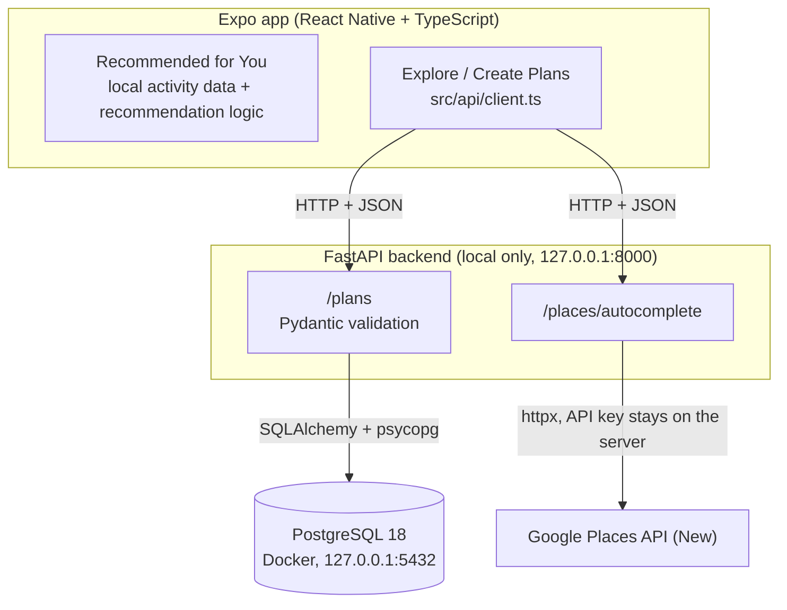
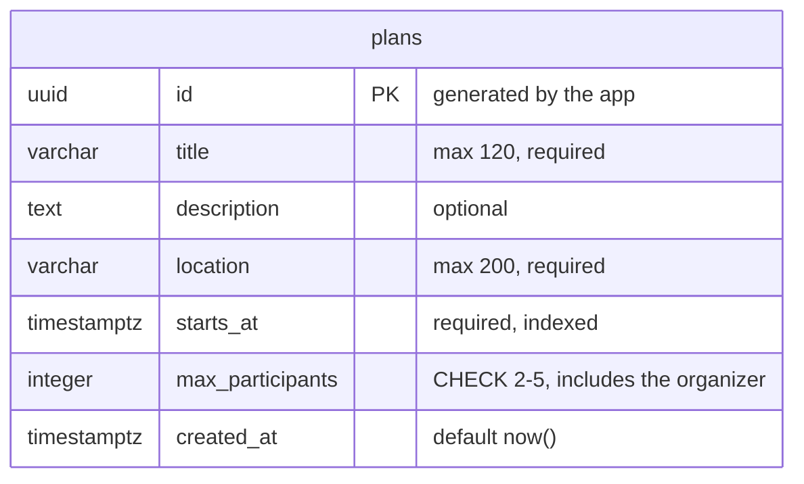
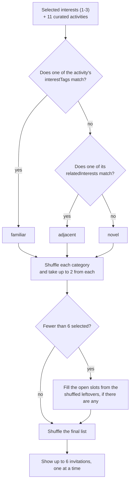

# Diagrams

These diagrams describe the code as it is as of Sprint 1.

## 1. Architecture



- Recommended for You runs entirely in the app and doesn't use the backend.
- The web app is deployed on Vercel without an API URL, so only Recommended for You is available there. Explore and Create Plans work locally.

## 2. Database schema



- There is one table so far, defined by the `Plan` model in `backend/app/models.py`.
- The API's input and output are separate Pydantic schemas (`PlanCreate`, `PlanRead`), so clients can't set `id` or `created_at`.
- Plans can only start between 9:00 and 19:00 San Francisco time. The API checks this; the database stores the exact moment in UTC.

## 3. Recommendation algorithm



- The code is in `src/recommendation/recommendations.ts`.
- Familiar is checked first, so an activity that matches both directly and through a related interest counts as familiar.
- The classifications are only shown in the researcher summary at the end, never to participants during the flow.

## Updating the images

The README shows these diagrams as PNG files in `docs/images/`. After changing a diagram here, regenerate them from the repo root:

```bash
npx -y @mermaid-js/mermaid-cli@11 -i docs/diagrams.md -o docs/images/diagram.png -b white -s 2
```
